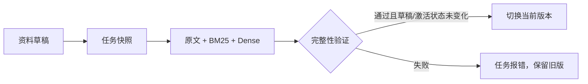

# 第四课：资料变了，怎样让问答可靠地使用新版

## 面试重点

1. 内容变更与索引发布分开：保存文档只是改草稿，不立即改变用户看到的答案。
2. 增量的是向量化请求：复用未变文本的向量，两个索引仍按完整快照构建。
3. 一次问答固定一版资料：发布与回滚可以发生在旁边，这次回答和引用始终来自同一版。

## 先沿同一个例子走一遍

这是一份教学构造通知，不是学校政策：申请截止日期为2月5日。打开 `/manage`，保存草稿并提交构建。系统先把提交时的所有片段和草稿修订号记入任务，再由后台工作线程构建索引。提交接口返回任务编号，不等待整套索引完成。

现在把正文改成2月8日。保存后，旧版仍可查询到2月5日；提交新任务并发布成功，才切到2月8日。这段等待是有意保留的：让用户始终看到一套完整资料，避免一部分变新、一部分留旧。

任务执行到一半又改文档怎么办？任务继续使用自己提交时的快照，但完成后发现草稿修订号已改变，就只保留为待激活版本，不能自动覆盖当前版。构建期间如果人为回滚，激活代数也会改变，正在执行的任务同样不能自动覆盖这次回滚。

代码入口：`app/knowledge.py` 的 `submit` 捕获资料，`_build` 在发布前检查修订号和激活代数，`app/knowledge_routes.py` 返回任务状态。

## 1. 保存文档与发布索引，为什么要分开

问答同时使用 BM25 和 Dense。BM25 更新后、Dense 还没更新，同一道问题可能召回2月8日和2月5日两段矛盾内容。即便模型回答碰巧正确，这次请求的依据也不清楚。

因此一个版本目录同时保存原文、BM25、Dense，以及描述这些文件的清单。构建结束后验证文件校验值、语料一致性、向量行数与模型配置，再在 SQLite 的同一个事务里记入版本、完成任务并切换激活指针。失败任务不会切指针，旧版继续服务。

实现没有声称文件目录与 SQLite 共同组成一个跨系统事务：先写完整文件并验证，再提交数据库指针。意外退出可能留下未登记的目录，但不会把半成品作为激活版。文件系统的任意断电恢复、磁盘硬件故障不是当前验证范围。

## 2. 哈希怎么减少重复向量化

缓存键由“模型与预处理配置 + 原始片段文本”共同计算。同一文本且配置不变，可以直接读取已有的向量；文字变化或配置变化，就需要重新编码。标题变化但向量输入正文未变，可以复用向量，版本中的标题仍会更新。

真实接口验证在14,406个原始片段旁边新增了一段教学资料：第一版只编码1段；把日期改成2月8日，第二版仍只编码1段，14,406段复用；删除教学文档后，新编码数为0。见 `artifacts/reports/knowledge_lifecycle_http.json`。

缓存还检查向量字节校验值、维度、有限值和归一化。损坏的缓存作为未命中处理，再请求编码。这个缓存避免重复计算，但不能保证供应商从未更新同名模型权重；当前远端服务没有提供可锁定的权重修订号。

必须区分两件事：本项目做了**增量向量化**，但 BM25 和完整向量矩阵仍重新生成版本快照。没有把它包装成向量数据库的增量写入，也没有使用百万级 ANN 检索。

## 3. 为什么要在请求开始时固定版本

假设请求开始时当前版本是 v1，系统已经取出了“2月5日”的证据。这时后台把当前版切到 v2。若生成或引用查询又读取一次“当前版本”，就可能拿到2月8日的原文，对不上刚才的证据。

现在 `app/api.py` 在检索开始前调用 `pin`，取得 v1 的检索器快照；返回的片段携带版本号和内容哈希，生成直接使用这些片段，不再次读取当前库。最后答案及实际证据都标明 v1。下一次请求才取得 v2。

`tests/test_knowledge.py` 特意在生成函数中触发切版：当全局当前版已回滚，这次进行中的回答和引用仍返回其检索时的版本。这是请求一致性的验证，不是模型回答正确率评测。

## 删除、回滚和重启的边界

- 删除先修改草稿，发布后从两种索引中移除。已有历史版本仍保留该文档，回滚会重新看见；这不是敏感资料永久擦除功能。
- 回滚只切换查询版本，不修改草稿。下一次构建仍按草稿执行。
- 任务与快照保存在 SQLite。重启后继续排队中的任务；被终止时正在执行的任务标为失败，要求重新提交，不偷偷假装完成或自动重复执行。
- 使用一个服务进程、一个后台工作线程，并用进程文件锁防止第二个写入服务。不是 Redis/Celery 分布式任务集群。
- 本机页面没有账户认证或企业权限，监听127.0.0.1；source_id只是检索范围。

已有离线测试覆盖失败构建、文件损坏拒绝激活、缓存变更、排队快照、重启、并发回滚和请求版本一致性。真实模型接口验证覆盖更新后的答案、回滚后的答案，以及删除后的无证据分支。两类证据分别说明实现逻辑与真实服务闭环，不能混称全部为真实模型测试。

## 面试时可以怎样解释

“我在现成中文资料和检索评测底座上，增加了知识库更新链路。文档先进入草稿，任务保存当时的资料快照，内容没变就复用向量；BM25、Dense与原文一起构建并验证，通过后才切换当前版本。每次问答固定版本并返回引用依据，因此构建失败、后台发布或回滚不会让一次回答混用两版资料。我通过真实接口验证了日期更新、回滚和删除，也通过离线测试检查了中途修改、构建失败和重启的处理。”

这是一段有代码和报告依据的练习稿，不代表学习者已经独立掌握。先沿日期变化理解输入、输出与边界，遇到卡点再解释对应函数。
